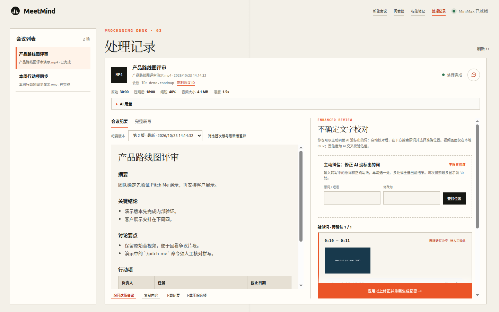
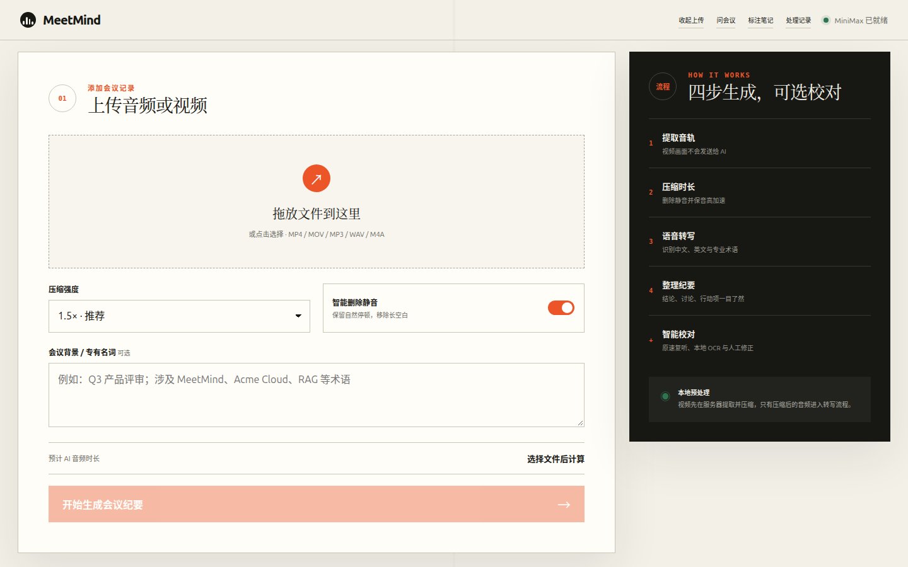
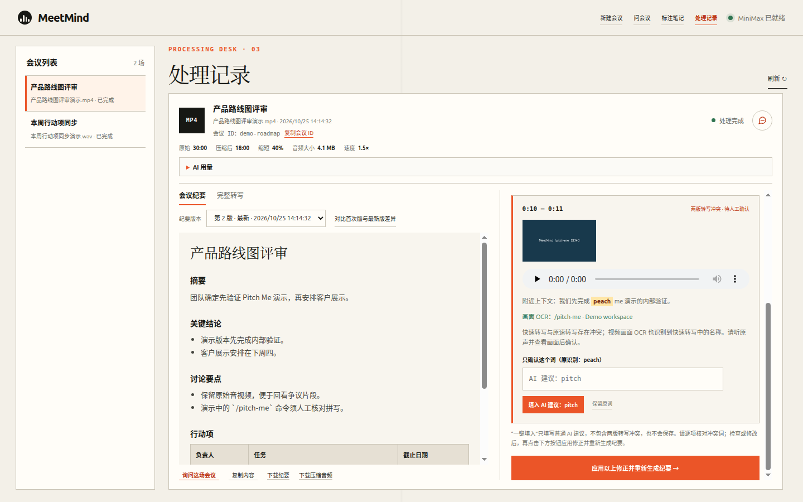
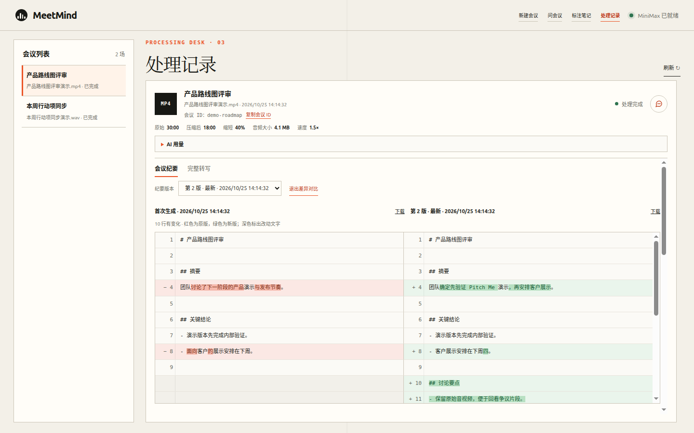
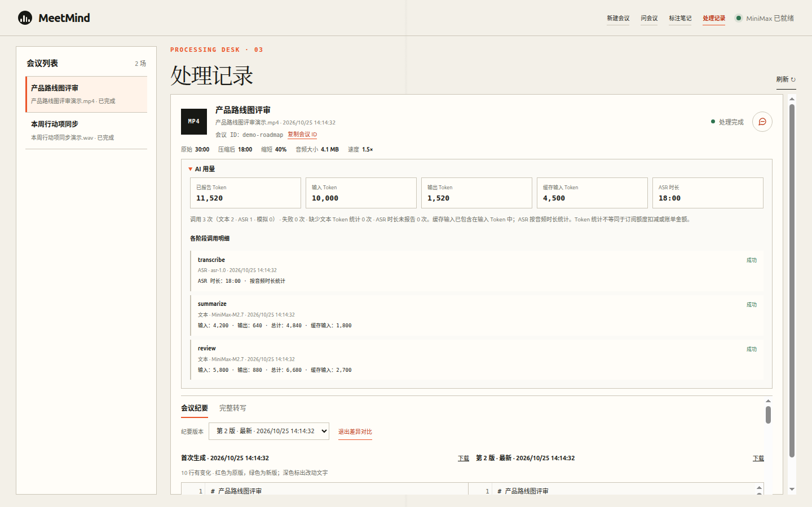
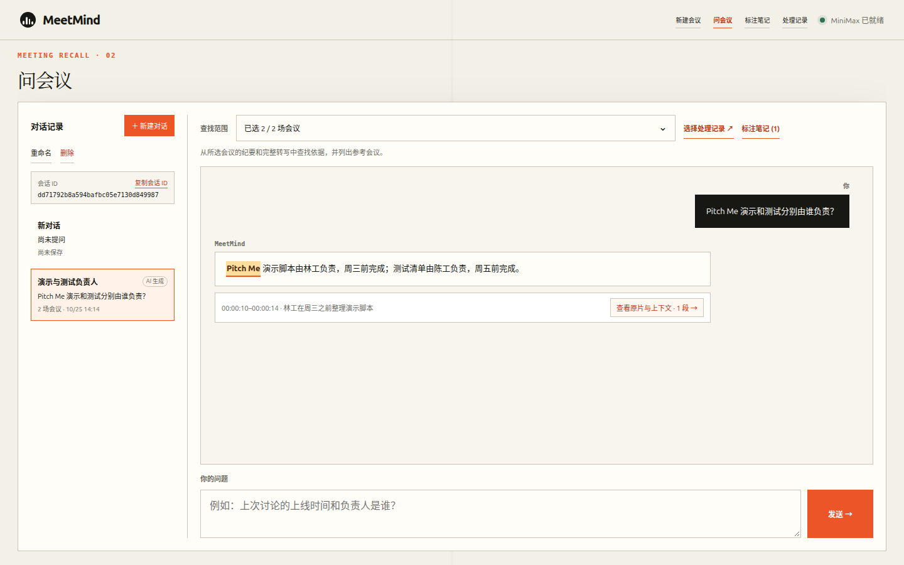
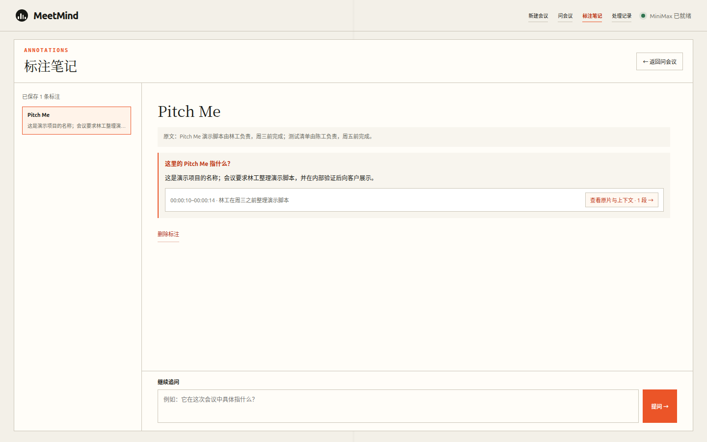
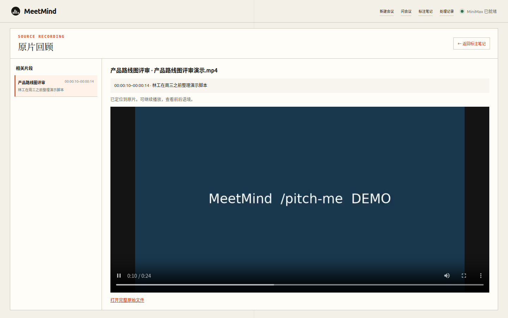

# MeetMind

**Turn meeting audio and video into shorter audio, full transcripts, actionable minutes, and answers you can verify against the original recording.**

[简体中文](README.md) · [English](README.en.md)



> All screenshots use fictional meeting data and the default MiniMax example configuration. The silent videos tour real interface states; they contain no private meeting content. The current application interface is in Chinese.

## Watch the workflow

| 15 sec: upload → minutes → Q&A → notes → source playback | 11 sec: audio and OCR review → version diff → AI usage |
| --- | --- |
| [](docs/media/overview.mp4) | [](docs/media/quality-review.mp4) |
| [Play product tour (MP4)](docs/media/overview.mp4) | [Play review tour (MP4)](docs/media/quality-review.mp4) |

## Feature overview

| Stage | What MeetMind does |
| --- | --- |
| Input and compression | Accepts MP4, MOV, MKV, WebM, MP3, WAV, M4A, AAC, FLAC, and OGG. FFmpeg extracts the first audio track, removes long silences, and speeds it up by 1×–2× without changing pitch. Output is a 16 kHz mono, 32 kbps MP3. |
| Long recordings | Splits compressed audio longer than 300 seconds for the configured transcription service. Temporary 429/5xx errors get up to three backoff retries; failed jobs can be retried from the web UI. |
| Structured minutes | The configured text model produces a summary, decisions, discussion points, action items, and open questions. Download the full transcript, minutes, or compressed audio. |
| Evidence based review | An optional original speed, word timed transcription highlights likely errors. It compares fast and detailed ASR, checks later video frames with local RapidOCR, and requires individual human confirmation for conflicting words. |
| Manual corrections and memory | Search for mistakes the model missed and select exact occurrences. Confirmed edits preserve the previous transcript and regenerate minutes. Unambiguous corrections may help later meetings; ASR conflicts remain scoped to the current meeting. |
| Minutes history | Keep each successful version, switch between versions, compare the first and latest line by line, and download either version. |
| Ask your meetings | Ask follow-up questions across one, several, or all completed meetings. Answers include source excerpts that open the original audio or video at the relevant time. Conversations and their meeting scopes are saved locally. |
| Annotation notes | Select a phrase in an answer, save its general and meeting-specific meaning, ask follow-up questions, and revisit the source. A single English word can also show pronunciation, examples, and browser speech. |
| Usage and persistence | Inspect calls for transcription, summarization, review, and Q&A, including reported tokens, cached input, and ASR duration. Jobs, original files, chats, and notes remain available after restart. |
| CLI and agents | The `meetmind` CLI processes, reviews, searches, flags, and applies corrections synchronously. JSON output, explicit exit codes, and artifact paths support MCP tools and Skills. |

### Upload and process

Choose a speed, silence removal, and optional background context or technical terms. At 1.5×, a 30 minute recording becomes roughly 20 minutes before additional silence removal. Faster playback can increase transcription errors with strong accents or overlapping speech.


The job view shows progress, before and after duration, file size, and results. MeetMind retains the original media locally for playback and review.

### Minutes, history, and usage

Switch between minutes and transcript in one job. After a correction, compare the minutes versions. The usage panel shows each model call and the reported measurements.





### Human review with audio and video OCR

Review builds a word timed track from original speed audio, then extracts short audio clips and a few relevant video frames. Video OCR runs locally. Ordinary suggestions can be filled in for inspection as a batch; fast versus detailed ASR conflicts and agent flagged items need individual confirmation. Only applying corrections writes changes and regenerates minutes. You can also search for confident but incorrect words that AI did not flag.


### Source linked Q&A, notes, and playback

Questions use the selected meetings' latest minutes and full transcripts; for long histories, relevant transcript passages are retrieved. Questions without evidence should be answered as such. Source excerpts open the original recording at the cited time. For a meeting without a review track, the first seek may need time to build one.







## Run locally

Requires Python 3.11+, [uv](https://docs.astral.sh/uv/), and FFmpeg/FFprobe. This quick start uses the default MiniMax configuration; see [Model providers](#model-providers) for compatible alternatives.

```bash
cp .env.example .env
# Add MINIMAX_API_KEY to .env
uv sync
set -a && source .env && set +a
uv run uvicorn app.main:app --reload --port 18473
```

Open <http://127.0.0.1:18473>. On macOS, install FFmpeg with `brew install ffmpeg`. Production runs do not use the mock AI by default.

## CLI / MCP / Skills

The CLI can process a local file without starting the web server:

```bash
uv run meetmind process /absolute/path/meeting.mp4 --speed 1.5 --context "Project weekly meeting"
uv run meetmind show <job-id>
uv run meetmind list

# Optional word-level review
uv run meetmind review <job-id>
uv run meetmind pending <job-id>
uv run meetmind search <job-id> "word to check"
uv run meetmind flag <job-id> "word to check" --segment-index 0 --term-start 12 --reason "Audio is unclear"
uv run meetmind apply <job-id> --input corrections.json
```

`process` runs synchronously. Data commands write one JSON line to stdout with status, transcript, minutes, usage, and absolute `artifacts` paths; errors go to stderr. Exit code `0` means success, `1` a processing or review failure, and `2` an invalid call or input. `review` / `show` include context, suggestions, OCR, and audio/frame evidence paths; `pending` returns only unresolved items, while `search` finds exact positions. Leave uncertain items pending or use `flag` for human review.

Example `apply` input:

```json
{
  "corrections": [{"item_id": "review-item-id", "replacement": "confirmed term"}],
  "manual_corrections": []
}
```

Use `--context-file` for UTF-8 background text; `--context-file -` and `--input -` read stdin. `retry <job-id>` reruns a failed job. `uv run meetmind serve` starts the web UI and accepts `--host`, `--port`, and `--reload`. To use a separate data directory, place `--data-dir /absolute/path/meetmind-data` before the subcommand.

## Model providers

By default, `MINIMAX_API_KEY` is used for both MiniMax transcription and text. You can replace either service independently, or configure two different services:

```dotenv
MEETMIND_ASR_API_KEY=your-asr-key
MEETMIND_ASR_BASE_URL=https://speech.example.com/v1
MEETMIND_ASR_API_FORMAT=openai
MEETMIND_TRANSCRIPTION_MODEL=your-asr-model

MEETMIND_TEXT_API_KEY=your-text-key
MEETMIND_TEXT_BASE_URL=https://chat.example.com/v1
MEETMIND_TEXT_API_FORMAT=openai
MEETMIND_SUMMARY_MODEL=your-chat-model
```

Here `openai` means the service implements the request and response format of `POST /v1/audio/transcriptions` or `POST /v1/chat/completions`; **it does not require OpenAI as the vendor**. Each custom service needs its own URL and key so the default key is never sent to a different host. Base URLs may end in `/v1` or at the host root. Text responses must include `choices[0].message.content`. If a text service requires `max_completion_tokens` instead of the default `max_tokens`, set `MEETMIND_TEXT_MAX_TOKENS_FIELD=max_completion_tokens`.

Basic transcription needs a JSON `text` field. Word-level review additionally needs `response_format=verbose_json`, `timestamp_granularities[]=word`, and a `words` array containing `word`, `start`, and `end`. A model that only supports basic transcription can still produce minutes, but cannot run word-level review. File limits, parameter support, and usage reports vary by provider; choose a service that accepts 300 second MP3 chunks and verify its actual behavior. The MiniMax-specific format remains available with `minimax`; see `.env.example`.

## Configuration and data

| Variable | Default | Purpose |
| --- | --- | --- |
| `MINIMAX_API_KEY` | empty | Shared key for the default MiniMax speech and text services |
| `MEETMIND_MINIMAX_BASE_URL` | `https://api.minimaxi.com` | China endpoint; international accounts can use `https://api.minimax.io` |
| `MEETMIND_ASR_API_KEY` / `MEETMIND_ASR_BASE_URL` | empty | Custom speech service key and base URL; configure both |
| `MEETMIND_ASR_API_FORMAT` | inferred | MiniMax by default; `openai` when a custom speech service is configured |
| `MEETMIND_TEXT_API_KEY` / `MEETMIND_TEXT_BASE_URL` | empty | Custom text service key and base URL; configure both |
| `MEETMIND_TEXT_API_FORMAT` | inferred | MiniMax by default; `openai` when a custom text service is configured |
| `MEETMIND_TRANSCRIPTION_MODEL` | `asr-1.0` | Speech model; change for another service |
| `MEETMIND_SUMMARY_MODEL` | `MiniMax-M2.7` | Text model shared by minutes, Q&A, and review suggestions |
| `MEETMIND_TEXT_MAX_TOKENS_FIELD` | format dependent | `max_tokens` for `openai`, `max_completion_tokens` for MiniMax |
| `MEETMIND_DATA_DIR` | `./data` | Local job and conversation data |
| `MEETMIND_MAX_UPLOAD_MB` | `2048` | Per-file upload limit |

The default MiniMax ASR limits a single file to 50 MB and 500 seconds. MeetMind compresses first, then splits longer audio into pieces of at most 300 seconds; check other services' own limits. The default flow sends only compressed audio to the configured speech service and meeting text to the configured text service. Starting review additionally sends original speed audio for word timing; RapidOCR processes video frames locally. Data lives under `data/jobs/<job-id>/`, `data/chat_sessions.json`, `data/chat_notes.json`, and `data/corrections.sqlite3`, or under your configured data directory.

Usage comes from model API responses when reported. Cached input is already included in input tokens; ASR is tracked separately by reported audio seconds. Other services may omit or define these figures differently. Missing usage, unknown consumption from failed calls, and mock calls are identified. These figures are not subscription deductions or billing totals. Review confidence is a model estimate, not native ASR confidence; timing can also be imperfect, so replay the original for important decisions. This release is intended for single-machine use. A multi-user deployment still needs authentication, access control, retention policy, object storage, and a job queue.

## Development checks

```bash
uv run pytest
uv run ruff check .
```

Tests use a local mock AI and do not spend API credits.
